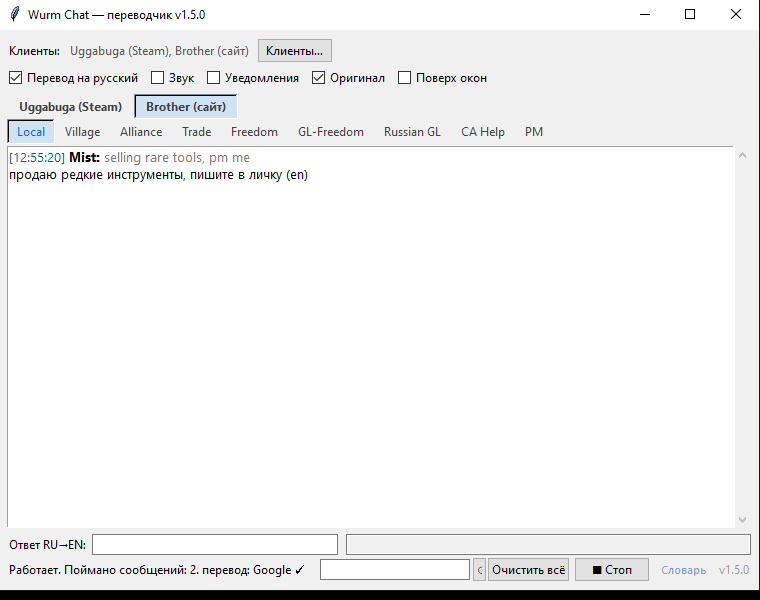

# Wurm Chat Translator

Переводчик чатов для игры **Wurm Online**. Отслеживает текстовые логи игры и показывает сообщения по каналам во вкладках, с переводом на язык игрока.

**English:** a chat translator for **Wurm Online** — it watches the game's text logs and shows channel messages in tabs, translated into the player's language. Works out of the box on Windows, no API keys.

**Português:** tradutor de chats para **Wurm Online** — acompanha os logs de texto do jogo e mostra as mensagens por canal em abas, traduzidas para o seu idioma. Funciona direto no Windows, sem chaves de API. [Versão completa em português ↓](#pt)

[](https://github.com/UggaBuga/wurm-chat-translator/releases/latest/download/WurmChatTranslator.exe)
[](https://github.com/UggaBuga/wurm-chat-translator/releases/latest/download/WurmChatTranslator.exe)
[](https://github.com/UggaBuga/wurm-chat-translator/releases)



## Возможности

- **Вкладки по каналам** — Local, Village, Alliance, Trade, Freedom, GL-Freedom, Russian GL, CA Help, PM; вкладка с новыми сообщениями подсвечивается ярко-синим, при открытии признак пропадает
- **Несколько клиентов** — для мультиоконной игры: кнопка «Клиенты…», по клиенту (со своей вкладкой верхнего уровня) на каждую копию игры — Steam и автономный клиент с сайта, сколько угодно; кнопка «Найти всех» обнаруживает папки логов всех клиентов по явному запросу; список клиентов сохраняется между запусками
- **Перевод чата на язык игрока** — через Google Translate (с паузами и повтором при ограничении), при недоступности — запасной сервис MyMemory; сообщения уже на целевом языке не переводятся; работает «из коробки», без настроек и ключей API
- **Язык интерфейса и перевода: Auto / Русский / English / Português / Deutsch / Español / Français / 中文** — по умолчанию определяется по языку клиента Steam; названия в списке выбора — на родных языках, так что случайно выбранный китайский легко переключить обратно; вся обводка приложения (включая диалоги и уведомления) переводится на выбранный язык
- **Папка логов сохраняется навсегда** — путь, указанный пользователем, не подменяется автоматически ни при каких запусках; кнопка «Найти» ищет папку логов по явному запросу (Steam-версия и автономный клиент с сайта), при несовпадении ника — по самому свежему персонажу
- **Галочки**: «Перевод на …» (вкл. по умолчанию), «Оригинал» (показывает исходный текст, работает и для старых сообщений), «Звук», «Уведомления», «Поверх окон»
- **Торговые префиксы** — в чате Trade WTS → «Продам», WTB → «Куплю», WTT → «Обменяю», PC → «Прайсчек»; распознаётся серверный тег «(Cad)» и любой регистр
- **Игровая валюта** — суммы вида «20s» или «2g 50s 30c 40i» переводятся словами на целевом языке: «20 серебра», «2 золота, 50 серебра, 30 меди, 40 железа» (1g = 100s = 10000c = 1000000i); соседние суммы разделяются запятой, для русского числительные склоняются (1 золото / 20 серебра); отключается в «Настройки…»
- **Языковые чаты** — каналы вида «Russian GL» ведутся на родном языке: по умолчанию не переводятся вообще (отображаются как есть, валюта тоже); перевод включается опцией в «Настройки…»
- **Настройки** — кнопка «Настройки…» открывает окно с переключателями опций перевода; изменения применяются сразу, без перезапуска
- **Панель ответа** — поле ввода внизу окна: текст переводится по направлению из двух списков (компактные коды ru/en/pt/de/es/fr/zh; по умолчанию «основной язык → en»), результат копируется в буфер автоматически; **ПКМ по переведённому сообщению в чате → «Ответить»** — панель сама переключается на язык собеседника и фокус попадает в поле ввода
- **Ctrl-C в чате** — выделенный текст копируется в буфер обмена (Ctrl-C и Ctrl-Insert)
- **Игровой словарь** — термины Wurm в игровой лексике («deed» → «поселение», «wemp» → «вемп», «glimmersteel» → «глимерсталь», «90ql» → не «90кл», «spirit templar» → «храмовник»); известные термины защищаются до перевода и подставляются в точном виде (Google не переводит «nails» как «ногти»), плюс пост-обработка кривых переводов; файл `wurm_glossary.json` рядом с exe создаётся автоматически и его можно править — изменения подхватываются без перезапуска; работает для русского направления: прямая замена в переводе чата и обратная в панели ответа ru→en; ссылка «Словарь» в углу окна показывается только при русском направлении перевода
- **Ручной путь к логам** — добавляется через «Клиенты… → Добавить…», имеет приоритет и сохраняется
- Встроенная защита от зависания потоков (автоперезапуск наблюдателя), журнал отладки

## Что нового

**[v1.7.1](../../releases/tag/v1.7.1)** — словарь защищает термины до перевода: Google больше не переводит известные термины наугад («nails» → «ногти») — они прячутся в токены до перевода и подставляются в точном виде из словаря, а склейки слов вокруг них не появляются. Более 60 новых записей игрового сленга и сокращений (ty, cod, neg, wta, bsb, enchants CoC/WoA/BotD/LT/…, боги и др.). Новая вкладка «Event». В чатах без перевода (Russian GL) сообщения идут без пустых строк между ними. Копирование выделенного из чатов по Ctrl-C и вставка/вырезание в полях ввода по Ctrl-V/Ctrl-X (реальные Ctrl+C/V на Windows Tk приходят с пустым keysym и нативные привязки их не ловят). Префиксы Trade (WTS/WTB/PC/WTT) переводятся на текущем целевом языке, а не всегда на русском.

**[v1.7.0](../../releases/tag/v1.7.0)** — игровая валюта: суммы вида «20s», «2g 50s 30c 40i» переводятся словами на языке перевода («20 серебра», «2 золота, 50 серебра, 30 меди, 40 железа»; для остальных языков — соответственно). Суммы прячутся в защищённые токены до перевода, поэтому Google их не коверкает; соседние суммы разделяются запятой, русские числительные склоняются (1 золото, 20 серебра). Языковые чаты («Russian GL») по умолчанию не переводятся совсем — показываются как есть; обе опции переключаются в новом окне «Настройки…», изменения применяются без перезапуска.

**[v1.6.0](../../releases/tag/v1.6.0)** — язык интерфейса и перевода: Auto (определяется по языку клиента Steam) или выбор из Русский / English / Português / Deutsch / Español / Français / 中文; названия языков в списке — на родных, так что переключиться обратно всегда просто; весь интерфейс, диалоги и уведомления переводятся на выбранный язык; чат переводится на целевой язык. Панель ответа: выбор направления перевода из двух списков (компактные коды ru/en/…), по умолчанию «основной язык → en», выбор сохраняется; ПКМ по переведённому сообщению — «Ответить»: панель ответа сама переключается на язык собеседника и фокус ввода; копирование выделенного из чата по Ctrl-C; ссылка «Словарь» показывается только при русском направлении перевода.

**[v1.5.0](../../releases/tag/v1.5.0)** — поддержка нескольких клиентов для мультиоконной игры: список клиентов (кнопка «Клиенты…»), у каждого клиента — своя вкладка верхнего уровня с полным набором каналов внутри; «Найти всех» находит папки логов всех установленных копий игры (Steam + сайт-клиент) по явному запросу; список клиентов сохраняется между запусками, старый путь из версий < 1.5.0 мигрируется автоматически.

**[v1.4.0](../../releases/tag/v1.4.0)** — игровой словарь терминов Wurm (deed → поселение, wemp → вемп, glimmersteel → глимерсталь и т.д.) с пост-обработкой перевода; редактор словаря (ссылка «Словарь» в углу окна): правка прямо в ячейке по двойному щелчку, автосохранение, применение без перезапуска; обратная замена терминов в панели ответа RU→EN.

**[v1.2.0](../../releases/tag/v1.2.0)** — панель ответа RU→EN с автопереводом и копированием в буфер, автоматическая проверка обновлений, номер версии в окне.

**[v1.1.1](../../releases/tag/v1.1.1)** — один экземпляр приложения: при повторном запуске диалог «Активировать / Заменить / Отмена».

**[v1.1.0](../../releases/tag/v1.1.0)** — поиск по истории чатов, иконка в системном трее, индикатор состояния переводчика, вложенный curl для стабильного доступа к Google, автоматическое переключение на запасной сервис при блокировке, торговые префиксы (WTS/WTB/WTT/PC).

**[v1.0.0](../../releases/tag/v1.0.0)** — первый релиз: вкладки по каналам, перевод на русский (Google + MyMemory), автоопределение папки логов Steam, звук/уведомления.

Полный список изменений — на [странице релизов](../../releases).

## Запуск

Готовый `WurmChatTranslator.exe` — скачать со [страницы релизов](../../releases) (или собрать самому, см. ниже). Приложение сразу начинает следить за логами; папка логов подставляется автоматически.

Только новые сообщения — история до запуска не подгружается.

## Сборка exe

```bash
pip install pyinstaller
pyinstaller --onefile --windowed --name WurmChatTranslator wurm_chat_gui.py
```

Результат — `dist\WurmChatTranslator.exe`. Конфиг `wurm_chat_gui_config.json` и журнал `wurm_chat_gui_debug.log` создаются рядом с exe при запуске.

## Запуск из исходников

```bash
pythonw wurm_chat_gui.py
```

## Структура

| Файл | Назначение |
|---|---|
| `wurm_chat_gui.py` | Основное приложение: GUI, наблюдатель логов, перевод |
| `translator.py` | Модуль перевода (Google / MyMemory) |
| `wurm_log_watcher_ru.py` | Консольный прототип-наблюдатель (без GUI) |
| `wurm_chat_gui_config.json` | Настройки по умолчанию |

## Требования

- Windows, Wurm Online (Steam-версия)
- Python 3.10+ (только для запуска из исходников / сборки)

## Лицензия

MIT

---

<a id="pt"></a>

# Wurm Chat Translator — Português

Tradutor de chats para o jogo **Wurm Online**. Acompanha os logs de texto do jogo e mostra as mensagens por canal em abas, com tradução para o idioma do jogador.

[](https://github.com/UggaBuga/wurm-chat-translator/releases/latest/download/WurmChatTranslator.exe)
[](https://github.com/UggaBuga/wurm-chat-translator/releases)

## Recursos

- **Abas por canal** — Local, Village, Alliance, Trade, Freedom, GL-Freedom, Russian GL, CA Help, PM; a aba com mensagens novas é destacada em azul-brilhante e o marcador some ao ser aberta
- **Vários clientes** — para jogar em várias janelas: botão «Clientes…», um cliente (com sua própria aba de nível superior) por cada cópia do jogo — Steam e cliente standalone do site, quantos quiser; o botão «Encontrar todos» descobre as pastas de logs de todos os clientes a pedido; a lista de clientes persiste entre execuções
- **Tradução do chat para o idioma do jogador** — via Google Translate (com pausas e repetição quando limitado), quando indisponível — serviço reserva MyMemory; mensagens já no idioma de destino não são traduzidas; funciona «de fábrica», sem chaves de API
- **Idioma da interface e da tradução: Auto / Русский / English / Português / Deutsch / Español / Français / 中文** — por padrão detectado pelo idioma do cliente Steam; os nomes na lista de escolha aparecem nos idiomas nativos, então um chinês escolhido por acidente é fácil de trocar de volta; toda a interface do aplicativo (incluindo diálogos e notificações) é traduzida para o idioma escolhido
- **Pasta de logs salva para sempre** — o caminho indicado pelo usuário nunca é substituído automaticamente em nenhum lançamento; o botão «Encontrar» localiza a pasta de logs a pedido (versão Steam e cliente standalone do site), e se o nick não coincidir — pelo personagem mais recente
- **Caixas de seleção**: «Traduzir para …» (ligada por padrão), «Original» (mostra o texto original, vale também para mensagens antigas), «Som», «Notificações», «Sempre por cima»
- **Prefixos de trade** — no canal Trade WTS → «Продам» ("vendo"), WTB → «Куплю» ("compro"), WTT → «Обменяю» ("troco"), PC → «Прайсчек» ("consulta de preço"); reconhece a tag de servidor «(Cad)» e qualquer caixa
- **Moeda do jogo** — valores como «20s» ou «2g 50s 30c 40i» são traduzidos por extenso no idioma de destino: «20 серебра», «2 золота, 50 серебра, 30 меди, 40 железа» (1g = 100s = 10000c = 1000000i); valores adjacentes são separados por vírgula e os numerais russos são declinados (1 золото / 20 серебра); pode ser desligado em «Configurações…»
- **Canais de idioma** — canais como «Russian GL» são conduzidos no idioma nativo: por padrão não são traduzidos (exibidos como estão, moeda incluída); a tradução pode ser ligada nas «Configurações…»
- **Configurações** — o botão «Configurações…» abre uma janela com alternadores de opções; as alterações se aplicam imediatamente, sem reiniciar
- **Painel de resposta** — campo de entrada na parte inferior: o texto é traduzido na direção escolhida em duas listas (códigos compactos ru/en/pt/de/es/fr/zh; por padrão «idioma principal → en»), o resultado é copiado automaticamente para a área de transferência; **clique direito numa mensagem traduzida no chat → «Responder»** — o painel muda sozinho para o idioma do interlocutor e o foco vai para o campo de entrada
- **Ctrl-C no chat** — o texto selecionado é copiado para a área de transferência (Ctrl-C e Ctrl-Insert)
- **Glossário do jogo** — termos de Wurm na léxica do jogo («deed» → «поселение», «wemp» → «вемп», «glimmersteel» → «глимерсталь», «90ql» não vira «90кл», «spirit templar» → «храмовник»); termos conhecidos são protegidos antes da tradução e inseridos em forma exata (o Google não traduz «nails» como «ногти»); o arquivo `wurm_glossary.json` ao lado do exe é criado automaticamente e pode ser editado — as alterações valem sem reiniciar; vale para a direção em russo: substituição direta na tradução do chat e reversa no painel de resposta ru→en; o link «Словарь» no canto da janela aparece apenas na direção de tradução em russo
- **Caminho manual para os logs** — adicionado em «Клиенты… → Добавить…», tem prioridade e é salvo
- Proteção integrada contra travamento das threads (auto-reinício do observador), log de depuração

## Novidades

**[v1.7.1](../../releases/tag/v1.7.1)** — o glossário protege os termos antes da tradução: o Google não traduz mais os termos conhecidos ao acaso («nails» → «ногти») — eles são escondidos em tokens antes da tradução e inseridos em forma exata do glossário, e não aparecem mais colagens de palavras em volta deles. Mais de 60 novos registros de gíria e abreviações do jogo (ty, cod, neg, wta, bsb, encantamentos CoC/WoA/BotD/LT/…, deuses etc.). Nova aba «Event». Nos chats sem tradução (Russian GL) as mensagens vão sem linhas em branco entre elas. Cópia do selecionado dos chats com Ctrl-C e colar/cortar nos campos de entrada com Ctrl-V/Ctrl-X. Prefixos de Trade (WTS/WTB/PC/WTT) traduzidos no idioma de destino atual, e não sempre para o russo.

**[v1.7.0](../../releases/tag/v1.7.0)** — moeda do jogo: valores como «20s», «2g 50s 30c 40i» traduzidos por extenso no idioma da tradução («20 серебра», «2 золота, 50 серебра, 30 меди, 40 железа»; para os demais idiomas — de acordo). Os valores são escondidos em tokens protegidos antes da tradução, então o Google não os deturpa; valores adjacentes são separados por vírgula, numerais russos declinados (1 золото, 20 серебра). Canais de idioma («Russian GL») por padrão não são traduzidos — exibidos como estão; ambas as opções são alternadas na nova janela «Configurações…», as alterações valem sem reiniciar.

**[v1.6.0](../../releases/tag/v1.6.0)** — idioma da interface e da tradução: Auto (detectado pelo idioma do cliente Steam) ou escolha entre Русский / English / Português / Deutsch / Español / Français / 中文; os nomes dos idiomas na lista são nos idiomas nativos, então voltar atrás é sempre fácil; toda a interface, diálogos e notificações são traduzidos para o idioma escolhido; o chat é traduzido para o idioma de destino. Painel de resposta: escolha da direção da tradução em duas listas (códigos compactos ru/en/…), por padrão «idioma principal → en», a escolha é salva; clique direito numa mensagem traduzida — «Responder»: o painel de resposta muda sozinho para o idioma do interlocutor e o foco de entrada; cópia do selecionado do chat com Ctrl-C; o link «Словарь» aparece apenas na direção de tradução em russo.

**[v1.5.0](../../releases/tag/v1.5.0)** — suporte a vários clientes para jogo em várias janelas: lista de clientes (botão «Клиенты…»), cada cliente com sua própria aba de nível superior com o conjunto completo de canais dentro; «Encontrar todos» localiza as pastas de logs de todas as cópias instaladas do jogo (Steam + cliente do site) a pedido; a lista de clientes persiste entre execuções, o caminho antigo das versões < 1.5.0 migra automaticamente.

**[v1.4.0](../../releases/tag/v1.4.0)** — glossário de termos de Wurm (deed → поселение, wemp → вемп, glimmersteel → глимерсталь etc.) com pós-processamento da tradução; editor do glossário (link «Словарь» no canto da janela): edição direto na célula com duplo clique, salvamento automático, aplicação sem reiniciar; substituição reversa dos termos no painel de resposta RU→EN.

**[v1.2.0](../../releases/tag/v1.2.0)** — painel de resposta RU→EN com tradução automática e cópia para a área de transferência, verificação automática de atualizações, número de versão na janela.

**[v1.1.1](../../releases/tag/v1.1.1)** — instância única do aplicativo: no segundo lançamento o diálogo «Ativar / Substituir / Cancelar».

**[v1.1.0](../../releases/tag/v1.1.0)** — busca no histórico dos chats, ícone na bandeja do sistema, indicador do estado do tradutor, curl embutido para acesso estável ao Google, troca automática para o serviço reserva quando bloqueado, prefixos de trade (WTS/WTB/WTT/PC).

**[v1.0.0](../../releases/tag/v1.0.0)** — primeiro release: abas por canal, tradução para o russo (Google + MyMemory), auto-detecção da pasta de logs do Steam, som/notificações.

Lista completa de mudanças — na [página de releases](../../releases).

## Execução

O `WurmChatTranslator.exe` pronto — baixar da [página de releases](../../releases) (ou compilar você mesmo, veja abaixo). O aplicativo já começa a acompanhar os logs; a pasta de logs é preenchida automaticamente.

Apenas mensagens novas — o histórico antes do lançamento não é carregado.

## Compilando o exe

```bash
pip install pyinstaller
pyinstaller --onefile --windowed --name WurmChatTranslator wurm_chat_gui.py
```

O resultado é `dist\WurmChatTranslator.exe`. O config `wurm_chat_gui_config.json` e o log `wurm_chat_gui_debug.log` são criados ao lado do exe ao executar.

## Executando do código-fonte

```bash
pythonw wurm_chat_gui.py
```

## Estrutura

| Arquivo | Finalidade |
|---|---|
| `wurm_chat_gui.py` | Aplicativo principal: GUI, observador de logs, tradução |
| `translator.py` | Módulo de tradução (Google / MyMemory) |
| `wurm_log_watcher_ru.py` | Protótipo de observador em console (sem GUI) |
| `wurm_chat_gui_config.json` | Configurações padrão |

## Requisitos

- Windows, Wurm Online (versão Steam)
- Python 3.10+ (apenas para execução do código-fonte / compilação)

## Licença

MIT
